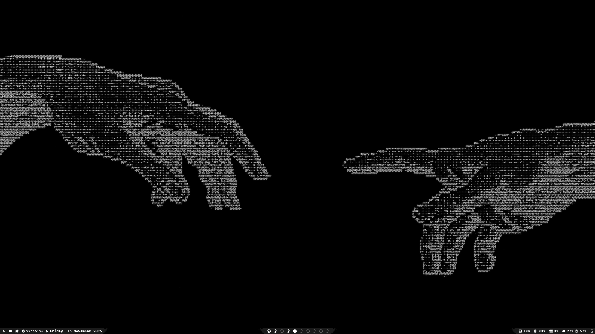

# >_

## ≧◡≦

- **OS:** Arch Linux [ArchLinux](https://github.com/archlinux)
- **Window Manager:** [bspwm](https://github.com/baskerville/bspwm)
- **Audio Server:** [PipeWire](https://pipewire.org/)
- **Login Manager:** [LightDM](https://github.com/ubuntu/lightdm)
